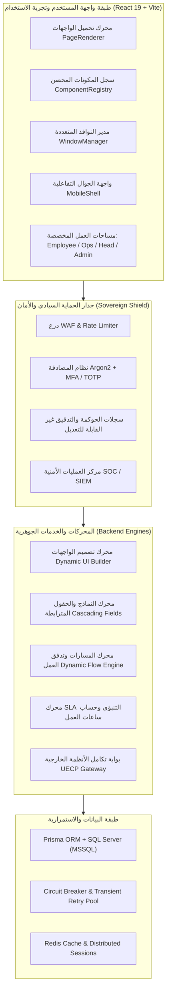

# التقرير المعماري الشامل والتشخيص الدقيق لنظام LITC-TS v43.5 Enterprise

هذا التقرير يوثق الحالة الحالية لكافة طبقات النظام (قواعد البيانات، نماذج Prisma، وحدات التحكم، محركات التشغيل، الواجهات الديناميكية، وبوابات الربط الخارجي)، ويضع خارطة الطريق للوصول إلى أعلى المعايير العالمية (Global Enterprise Standards).

---

## 🏛️ 1. الهيكل المعماري والتقني للمنظومة (Architecture Blueprint)

---

## 🔍 2. تفكيك وتحليل أجزاء النظام الجوهرية (Deep-Dive Analysis)

### 1️⃣ محرك الواجهات الديناميكية وتخصيص تجربة المستخدم (Metadata-Driven Dynamic UI Engine)
* **المسار والمكونات:** `UILayoutEngineTab.tsx`, `LayoutEngineLanding.tsx`, `ComponentRegistry.ts`.
* **طريقة العمل:**
  * يتيح للمسؤول بناء واجهات وتخصيصها لكل مستخدم أو قسم أو دور عبر تقنية السحب والإفلات (**Drag & Drop**).
  * حماية تامة ضد هجمات *Prototype Pollution* عبر تجميد كائن السجل وتسجيل المكونات المصرح بها فقط.
  * عزل أخطاء الرندر لكل مكون ديناميكي من خلال `ErrorBoundary` حتى لا تنهار بقية الشاشة إذا تعطل مكون واحد.
  * دعم بيئة نوافذ تفاعلية متعددة المهام (`WindowManager` + `FloatingTaskbar`).

### 2️⃣ محرك النماذج والحقول المترابطة (Dynamic Fields & Form Schema)
* **المسار والمكونات:** `DynamicFieldsTab.tsx`, `DynamicFormCreator.tsx`, `FormSchema`.
* **طريقة العمل:**
  * تعريف حقول ديناميكية بنوعيات متعددة (نصوص، قوائم منسدلة، تواريخ، ملفات، مربعات اختيار).
  * دعم **القوائم التتابعية المترابطة (Cascading / Child Bindings)** مثل: (اختيار المبنى ⬅️ تحميل طوابقه تلقائياً ⬅️ تحميل المكاتب التابعة).
  * ربط مخطط الحقول (`FormSchema`) بمسارات تذاكر محددة لإظهار حقول مخصصة لكل نوع طلب.

### 3️⃣ محرك المسارات وسير العمل (Ticket Routing & Workflow / Flow Engine)
* **المسار والمكونات:** `TicketRoutingTab.tsx`, `FlowEngineService.ts`, `WorkflowEngine.ts`.
* **طريقة العمل:**
  * توجيه ذكي حسب الأقسام والشُعب والفرق واستراتيجيات التوزيع (`POOL`, `PULL`, `ROUND_ROBIN`).
  * دعم مراحل متعددة للطلب (`FlowStep`) مع تحديد المسؤولين وصلاحيات الاعتماد والرفض والتحويل المتسلسل.
  * **حوكمة قفل الأبناء (Parent-Child Governance):** نظام صارم يمنع إغلاق التذكرة الرئيسية إلا بعد إغلاق كافة التذاكر والمهام الفرعية المنبثقة منها (Zero Ticket Leak).

### 4️⃣ محرك اتفاقيات مستوى الخدمة والتصعيد الآلي (SLA & Escalation Engine)
* **المسار والمكونات:** `SLACalculatorService.ts`, `SLARoutingEngine.ts`, `NotificationEngine.ts`.
* **طريقة العمل:**
  * حساب دقيق لمهلة الإنجاز استناداً إلى جدول ساعات العمل الرسمية والأعياد والعطلات.
  * تصعيد آلي للتذاكر المتأخرة وبث تنبيهات حية عبر **Server-Sent Events (SSE)** للمشرفين واللوحات التشغيلية.

### 5️⃣ بروتوكول ربط وتكامل المنظومات الخارجية (UECP - Unified External Component Protocol)
* **المسار والمكونات:** `ExternalSystemsTab.tsx`, `UECPGatewayController.ts`, `UECPMiddleware.ts`.
* **طريقة العمل:**
  * تسجيل الأنظمة الخارجية وتوليد مفاتيح الوصول والتوقيع الرقمي.
  * بوابات آمنة لاستقبال التذاكر من الأنظمة الخارجية مع التحقق المشدد من التوقيع الرقمي (**HMAC-SHA256 Signature**) ومنع تكرار المعاملات (**Idempotency Key**).
  * تسجيل وتدقيق كل طلب وارد وصادر وإثراء التذاكر بلقطات بيانات الأنظمة الخارجية.

### 6️⃣ منظومة الأمان والدرع السيادي ومركز العمليات (SOC / SIEM / WAF Shield)
* **المسار والمكونات:** `SecurityControlTab.tsx`, `SecurityController.ts`, `WAFMiddleware.ts`.
* **طريقة العمل:**
  * جدار ناري تطبيقي (WAF) لرصد وحظر هجمات الحقن وهجمات الحرمان من الخدمة (Rate Limiting).
  * مراقبة الجلسات المفتوحة للمستخدمين مع إمكانية طرد الجلسات المشبوهة فوراً.
  * تشفير كلمات المرور بخوارزمية **Argon2** الآمنة ودعم المصادقة الثنائية **MFA / TOTP**.
  * قاطع دائرة ثلاثي الحالات (**Tri-State Circuit Breaker**) لحماية قاعدة البيانات من الانهيار عند الضغط العالي.

---

## 🚀 3. خارطة طريق للوصول إلى أعلى المعايير العالمية (Global Standard Roadmap)

لجعل هذا النظام ينافس أقوى الأنظمة العالمية (مثل *ServiceNow*, *Jira Service Management*, *Zendesk Enterprise*):

1. **التناسق والتكامل الحي (End-to-End Persistence):** ربط كافة شاشات الإدارة ومحرك الواجهات بقاعدة بيانات SQL Server مباشرة عبر الـ APIs وتفادي الاعتماد الكامل على البيانات الوهمية (Mock Data).
2. **محرك الذكاء الاصطناعي (AI Ticket Triage & Copilot):** تصنيف التذاكر تلقائياً، اقتراح الحلول الذكية، وتحليل مشاعر الموظفين ورضاهم.
3. **منصة التكامل الشاملة (OpenAPI / Webhooks Marketplace):** بناء واجهات برمجية قياسية (REST + Webhooks) ومكتبة موصلات جاهزة للأنظمة الخارجية (SAP, Oracle, Active Directory).
4. **ذكاء الأعمال والتحليلات المتقدمة (Real-Time Executive BI):** مؤشرات أداء تفاعلية، تقارير تصدير متطورة، ومخططات زمنية لدعم متخذي القرار.
5. **التوافق الميداني والأوفلاين (PWA & Offline Sync):** إمكانية عمل الفنيين في الميدان دون اتصال بالإنترنت ومزامنة البيانات تلقائياً فور عودة الشبكة.

