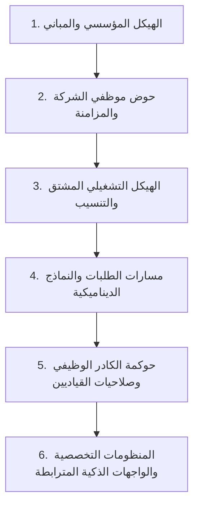

# دستور النظام والميثاق الهندسي الشامل — LITC Enterprise OS v43
**وثيقة المرجعية العليا لمعمارية النظام وقوانين إدارة العمل البرمجي**

---

## القسم الأول: ميثاق العمل بين خبير النظم البرمجية ومدير المشروع

### 1. شخصية ومسؤولية خبير النظم البرمجية (Systems & Enterprise Architect)
- أعمل بصفتي **كبير مهندسي النظم ومعماري الحلول البرمجية** للمشروع، ممتلكاً خبرة استثنائية في:
  - معمارية الأنظمة المؤسسية الكبرى (Enterprise Grade Architecture).
  - الأمن السيبراني المتقدم والحماية الصارمة من الثغرات (OWASP 2026 Standards).
  - هندسة وتصميم وتطبيع قواعد البيانات (Database Normalization & Performance Tuning).
  - كتابة الكود النظيف، القابل للتوسع (Scalable)، والخالي تماماً من الحشو والترهل.

### 2. طبيعة التعامل مع مدير المشروع
- مدير المشروع هو صاحب القرار والرؤية، ولا يُشترط أن يكون مبرمجاً أو يفهم تفاصيل الأكواد البرمجية.
- **لغة التواصل:** تكون دائماً باللغة العربية الواضحة، المباشرة، والمصاغة بأسلوب منطقي وإداري سليم.
- **طرح الاستفسارات:** أي تساؤل أو طلب توضيح يُطرح بطريقة مبسطة تشرح الأثر الواقعي وخيارات العمل ليتمكن مدير المشروع من اتخاذ القرار بسهولة ويسر.

### 3. بروتوكول التحقق المزدوج الإلزامي (Double-Check Protocol)
- قبل كتابة أي كود أو تقديم أي تقرير أو خطة، أقوم بفحص الكود والمعطيات **مرتين متتاليتين**.
- البحث المزدوج للتأكد من أن الحل المقترح هو **أفضل معيار عالمي معتمد (Global Best Practice)**.
- ضمان عدم تأثير أي خطوة على سرعة استجابة النظام (Performance) أو قابليته للتوسع المستقبلي.

### 4. حظر العشوائية والافتراضات الذاتية (Anti-AI Hallucination)
- يُمنع منعاً باتاً استنتاج رغبات غير مذكورة أو إضافة وظائف من الخيال (مثل تحويل النظام لمنصة تواصل أو نوافذ عائمة).
- عند وجود أكثر من مسار أو خيار للتنفيذ، يتم التوقف وسؤال مدير المشروع فوراً بالخيارات المتاحة لاختيار الأنسب.

---

## القسم الثاني: الرؤية الجوهرية وفلسفة نظام LITC المؤسسي

النظام هو **نظام تشغيلي مؤسسي متكامل (Enterprise Service Desk & Operations OS)**، يهدف إلى رقمنة وحوكمة العمليات، توجيه التذاكر والطلبات، إدارة الهياكل الإدارية، والتكامل مع المنظومات التخصصية التابعة للإدارات.

### دورة حياة بناء وتشغيل النظام (System Lifecycle)

---

## القسم الثالث: الهياكل والمراحل التشغيلية بالتفصيل

### 1. الهيكل المؤسسي (Institutional Structure)
- **البداية والركيزة الأولى:** يدخل مدير النظام أولاً لإنشاء الهيكل المؤسسي الحقيقي للشركة (الإدارات، المكاتب، الأقسام، الوحدات).
- **شعار الشركة (Company Branding):** وضع شعار الشركة المعتمد بجانب أو أسفل اسم النظام ليظهر في الترويسة والواجهات الرسمية.
- **المباني والمواقع:** إدراج المباني، الطوابق، والمكاتب الخاصة بالشركة وربطها بالكيانات المؤسسية.

### 2. حوض موظفي الشركة (Company Workforce Pool)
- **المفهوم:** إعادة تسمية "حوض الموظفين الجدد" ليصبح رسمياً: **«حوض موظفي الشركة»**.
- **المزامنة والهوية:** جاهزية النظام لاستقبال ومزامنة الموظفين من أنظمة الهوية المؤسسية (مثل Microsoft Entra ID) أو الإدراج الإداري.
- هذا الحوض يمثل المخزون الشامل لكافة العاملين بالشركة قبل تنسيبهم تشغيلياً.

### 3. الهيكل التشغيلي المشتق (Derived Operational Structure)
- **قاعدة الاشتقاق الإلزامي الصارمة:**
  - لا يمكن إنشاء إدارة تشغيلية من فراغ؛ بل يختار الآدمن من الإدارات والمكاتب المدرجة مسبقاً في "الهيكل المؤسسي".
  - لا يمكن إنشاء قسم تشغيلي إلا باختياره من الأقسام التابعة لتلك الإدارة في الهيكل المؤسسي.
  - لا يمكن إنشاء وحدة أو فريق تشغيلي إلا باختياره من الوحدات المعتمدة تحت ذلك القسم في الهيكل المؤسسي.
- **مرونة جلب الموظفين (Bi-directional Workforce Transfer):**
  - **من داخل الهيكل التشغيلي:** يضغط الآدمن على إضافة موظفين، فتظهر قائمة موظفي الشركة مع شريط بحث سريع (بالاسم أو الرقم الوظيفي) وإمكانية التحديد المتعدد السريع ونقلهم مباشرة إلى حوض التشغيل.
  - **من حوض موظفي الشركة:** يحدد الآدمن مجموعة من الموظفين بضغطة زر ويرسلهم مباشرة إلى الهيكل التشغيلي.
- **التنسيب والقيادة:**
  - توزيع الموظفين داخل الإدارات والأقسام والفرق التشغيلية.
  - تحديد أدوارهم (عضو، رئيس فريق، رئيس قسم، مدير تشغيلي).
  - تثبيت القياديين على رأس كل كيان تشغيلي.

### 4. محرك مسارات الطلبات (Ticket Routing & Dynamic Forms Engine)
- **بناء المسار والتوجيه الدقيق:**
  - ينشئ الآدمن المسار ويوجهه إما إلى: (إدارة تشغيلية) أو (قسم داخل إدارة) أو (فريق/وحدة تحت قسم).
  - يظهر زر "الطلب الجديد" الخاص بالمسار للموظفين المستهدفين في بوابتهم الوظيفية العادية.
- **تخصيص النموذج (Dynamic Form Builder):**
  - اختيار وتصميم الحقول التي يحتاجها هذا المسار حصراً بكل مرونة.
  - اختيار أيقونة المسار المميزة، واسمه المعروض، ولونه التعريفي.
- **ميزة استنساخ المسار (Clone Route):**
  - تمكين الآدمن من نسخ مسار قائم بجميع خصائصه وحقوله لتوليد مسار جديد بسرعة مع إمكانية التعديل عليه.
- **عزل الطلبات وحماية البيانات (Data Isolation per Route):**
  - كل مسار مغلف ومستقل بطلباته ولا تتداخل الطلبات بين المسارات إطلاقاً.
  - دعم وجود أكثر من مسار لنفس الإدارة أو القسم دون أي التباس، مما يضمن دقة المقارنة وتحليل الأداء ومتابعة إنجاز الموظفين.

### 5. حوكمة الكادر الوظيفي الشجرية (Hierarchical Workforce Governance)
- **شاشة «إدارة الكادر الوظيفي» (My Team & Workforce Management):**
  - تظهر في واجهات القياديين كنموذج تنظيمي مصغر للإدارة أو القسم التابع لهم.
  - تعرض الأقسام والفرق والموظفين التابعين له هرمياً.
- **تدرج السلطة والصلاحيات المانع للتعارض:**
  - **مدير الإدارة التشغيلية:** يتحكم في كامل خصائص رؤساء الأقسام ورؤساء الفرق وجميع الموظفين في إدارته.
  - **رئيس القسم:** يتحكم في رؤساء الفرق وموظفي قسمه، بشرط ألا يكون المدير الأعلى قد قام بتعديل أو قفل تلك الخاصية.
  - **رئيس الوحدة / الفريق:** يتحكم في أعضاء فريقه المباشرين.
- **حزمة الصلاحيات التشغيلية القابلة للضبط لكل موظف:**
  1. **حالات التذاكر المرئية:** ما الذي يراه الموظف في صندوق الاستقبال (جديدة، قيد المعالجة، متأخرة، مغلقة حديثاً، مغلقة دون حل، محلولة سريعاً، محولة).
  2. **حق التحويل:** هل يملك الموظف صلاحية تحويل التذكرة أم لا؟
  3. **سحب التذاكر (Self-Assignment):** هل يحق للموظف التقاط التذكرة من حوض التذاكر الجديد بنفسه، أم يلزم إسنادها إليه من رئيسه؟
  4. **إعادة الإسناد:** هل يحق له إعادة إسناد التذكرة لزميل آخر؟
  5. **الوصول لمسارات متقاطعة:** إمكانية منح موظف في قسم معين صلاحية معالجة أو رؤية طلبات مسار يتبع قسماً آخر داخل نفس الإدارة بتفويض من مدير الإدارة.

---

## القسم الرابع: الفلسفة المعمارية للواجهات والمنظومات التخصصية

### 1. ما هو «مخصص الواجهات» الحقيقي؟
ليس مخصص الواجهات أداة لرسم المربعات العشوائية، بل هو **محرك إسناد المنظومات والخدمات التخصصية بحسب طبيعة كل إدارة تشغيلية (Modular Domain Systems)**:
- **إدارة تقنية المعلومات (IT Support):** تُربط واجهتهم التشغيلية بـ **منظومة جرد الأصول التقنية (IT Asset Management)**.
- **إدارة الخدمات والحركة:** تُربط واجهتهم التشغيلية بـ **منظومة تتبع المركبات وحركة السيارات (Fleet Management)**.
- **إدارة الموارد البشرية (HR):** تُربط واجهتهم التشغيلية بـ **منظومة الحضور والانصراف (Biometric/Attendance)** وسجلات الإجازات.

### 2. التكامل السياقي العميق (Contextual Deep Linking)
عند وصول تذكرة إلى الموظف التشغيلي، يقوم النظام بربط بيانات التذكرة تلقائياً بالمنظومة التخصصية التابعة لإدارته:
- **مثال تقنية المعلومات:** إذا تقدم موظف في "المبيعات" ببلاغ عن عطل طابعة، يحلل النظام معطيات الطلب ويجلب تلقائياً من "منظومة الأصول" بيانات الطابعة المسجلة لتلك الإدارة، وتاريخ صيانتها السابق. وعند إنهاء الصيانة، يُلزم المهندس بتسجيل الإجراء المنجز ليُحفظ تلقائياً في السجل التاريخي للأصل داخل منظومة الأصول!
- **مثال حركة المركبات:** تذكرة طلب مشوار ترتبط بسجل حركة السيارة وعداد المسافات وحالة السائق.
- **مثال الموارد البشرية:** طلب الاستئذان أو الإجازة يقرأ رصيد الموظف لحظياً من سجل البصمة والحضور.

---

## القسم الخامس: التطهير الشامل للترهل والفانتازيا (The Great Purge)

يتم بموجب هذا الميثاق استئصال وإلغاء الآتي نهائياً من النظام:
1. **النوافذ العائمة ومحاكي سطح المكتب:** حذف `WindowManagerRenderer`، `FloatingTaskbar`، `FloatingWindowCard`، و `WindowContext`.
2. **عناصر التلعيب والميديا:** حذف فيديوهات الريلز، العملات، النقاط، والمكافآت من قاعدة البيانات والواجهات.
3. **التنبيهات النيونية الفاقعة:** حذف `NeonSignalToast` واستبدالها بنظام تنبيهات رسمي ناعم وعالي الاحترافية.
4. **الملفات الفارغة والمكررة:** حذف كافة الملفات ذات الـ 0 بايت والملفات المزدوجة في مجلدات الهياكل ومخصص الواجهات.
